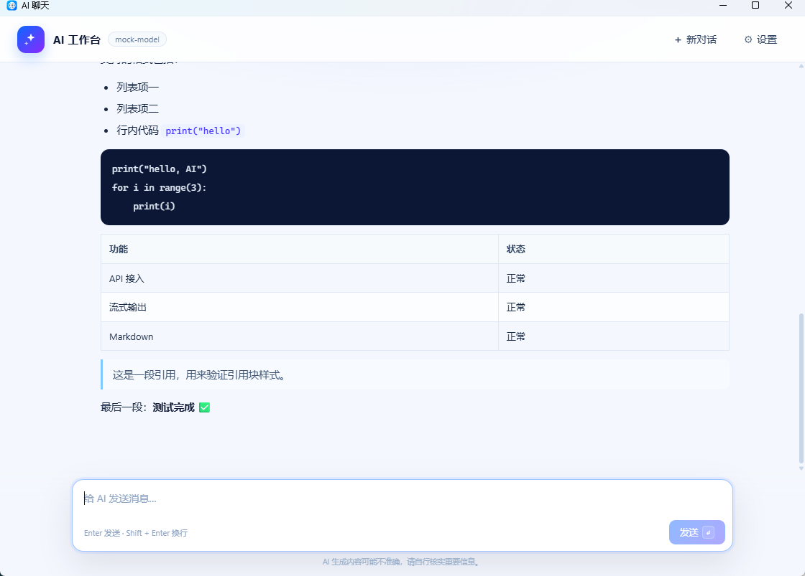

# AI Studio

一个本地运行的极简 AI 聊天工作台：**OpenAI 兼容 API + SSE 流式输出 + Markdown 实时渲染**。

使用 C# / WinForms 承载 Edge WebView2，前端使用原生 HTML/CSS/JavaScript。
适合作为学习桌面应用、前后端桥接、HTTP 流式接口和 Markdown 安全渲染的示例项目。



## 功能

- 接入任意 OpenAI 兼容的 Chat Completions 接口
- SSE 流式输出，边生成边显示
- Markdown 实时渲染：标题、列表、表格、代码块、引用
- 支持停止生成、复制回复、新对话
- API 地址、Key、模型名可配置
- API Key 使用 Windows DPAPI 加密保存
- 聊天记录保存在本机，重新打开自动恢复
- 外部链接使用系统默认浏览器打开

## 技术栈

- C# / .NET Framework 4.8 / WinForms
- Microsoft Edge WebView2
- HTML / CSS / JavaScript
- marked（Markdown 解析）
- DOMPurify（HTML 安全过滤）
- HttpClient + Server-Sent Events（SSE）

## 快速开始

### 环境要求

- 64 位 Windows 10 / 11
- .NET Framework 4.x（Windows 10/11 默认自带）
- Microsoft Edge WebView2 运行时（Edge 一般自带）
- PowerShell
- 首次构建需要联网下载 WebView2 SDK（NuGet）

### 构建与运行

```powershell
git clone <your-repo-url>
cd ai-studio

powershell -NoProfile -ExecutionPolicy Bypass -File .\build-ai-chat.ps1
.\AI聊天.exe
```

仓库不提交 `.exe` 和 WebView2 的 DLL，构建脚本会自动生成 EXE，并在缺失时下载
WebView2 SDK。首次启动 WebView2 可能需要几秒钟。

### 配置 API

第一次启动会弹出设置窗口，填写：

- **API 地址**：Base URL，通常以 `/v1` 结尾
- **API Key**：你自己的密钥
- **模型名称**：接口支持的模型

示例：

| 服务 | API 地址 | 模型示例 |
|---|---|---|
| DeepSeek | `https://api.deepseek.com/v1` | `deepseek-chat` |
| OpenAI | `https://api.openai.com/v1` | `gpt-4o-mini` |
| Ollama | `http://localhost:11434/v1` | `qwen2.5:7b` |

Ollama 的 API Key 可以留空。

## 项目结构

```text
ai-studio/
├─ AI聊天.cs              C# 主程序：窗体、WebView2、设置、API 客户端
├─ ai-ui/
│  ├─ index.html         聊天界面
│  ├─ styles.css         界面样式
│  ├─ app.js             消息、流式渲染、Markdown
│  ├─ marked.min.js      Markdown 解析库
│  ├─ purify.min.js      HTML 安全过滤库
│  └─ THIRD-PARTY-NOTICES.txt
├─ build-ai-chat.ps1     独立构建脚本
├─ app.manifest          Windows 兼容性与 DPI
├─ web.ico               程序图标
├─ WebView2-LICENSE.txt  Microsoft WebView2 SDK 许可
├─ docs/screenshot.png   界面截图
└─ README.md
```

## 数据与安全

- 仓库中**不包含任何真实 API Key**。
- 程序运行时，设置保存在：
  `%LOCALAPPDATA%\AIWorkbench\settings.json`
- API Key 使用 Windows DPAPI（当前用户范围）加密，不以明文写入设置文件。
- 聊天记录和 WebView2 数据保存在：
  `%LOCALAPPDATA%\AIWorkbench\WebView2`
- AI 返回的 Markdown 经过 marked 解析，再用 DOMPurify 过滤后才插入页面。
- 页面 CSP 禁止外部脚本，并限制图片和连接来源。
- 外部链接会被拦截并交给系统默认浏览器打开。

如果你要 Fork 或修改这个项目，请不要把 `%LOCALAPPDATA%\AIWorkbench`
或任何包含 API Key 的文件提交到 Git。

## 当前限制

这是一个最小可用版本，不是完整的 AI 工作台：

- 单窗口、单会话
- 只支持 OpenAI 兼容的 Chat Completions 和 Bearer Token
- 不支持工具调用、RAG 知识库、图片/文件上传、多模态
- 不支持多模型同时对话、账号同步、插件

## 可继续练习的方向

- 多会话和左侧历史列表
- 系统提示词与模型预设
- 重新生成、编辑消息
- 导入/导出对话
- Token 用量统计
- 文件上传和 RAG
- 自动化测试和 CI 构建

## 第三方组件

- [Microsoft Edge WebView2](https://learn.microsoft.com/microsoft-edge/webview2/)：浏览器内核
- [marked](https://github.com/markedjs/marked)：MIT License
- [DOMPurify](https://github.com/cure53/DOMPurify)：Apache-2.0 / MPL-2.0

完整许可见 `ai-ui/THIRD-PARTY-NOTICES.txt` 和 `WebView2-LICENSE.txt`。

## License

仓库尚未添加开源许可证。发布前请根据你的意愿选择 MIT、Apache-2.0 或其他许可证。
